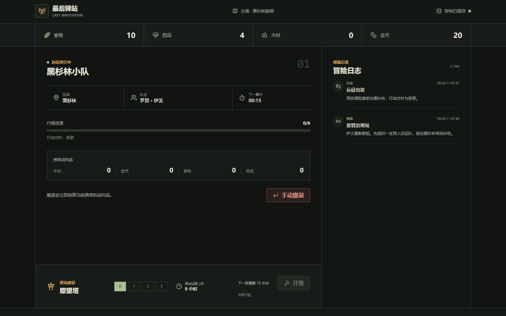
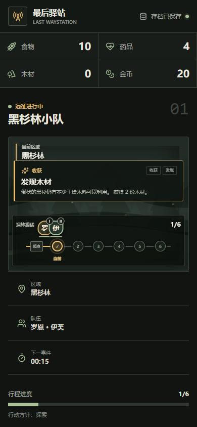

# Last Waystation / 最后驿站

> 当前已发布版本：`v0.1.0-alpha.0`。`Unreleased` 变更正在建设阶段 2A 的内容框架与存档兼容层，不增加新的正式玩法。

Last Waystation 是一款运行在浏览器中的单机挂机冒险游戏。玩家经营迷雾边境的最后一座驿站，派出两人小队探索黑杉林，并用带回的资源升级瞭望塔。项目采用纯前端架构，不需要服务器、数据库或账号。





## 在线试玩

在线试玩：[https://wxgith.github.io/last-waystation/](https://wxgith.github.io/last-waystation/)

## 当前可玩内容

- 从三名固定英雄中选择两人，采用谨慎、探索或逐利方针前往黑杉林。
- 消耗 2 份食物开始远征，每 15 秒处理一个事件，第 6 个事件后自动返程。
- 查看旅行、遭遇、战斗、奖励和返程日志，日志保留最新 200 条。
- 手动撤退并结算已获得的战利品；首次正常返程保证至少带回 10 份木材。
- 使用木材把瞭望塔从 0 级升级到 3 级，离线结算上限随等级提高。
- 自动保存到 `localStorage`，并支持 JSON 存档导出、导入、坏档隔离和重置。
- 桌面和移动端响应式界面，支持键盘操作和 `prefers-reduced-motion`。

## 本地运行

需要 Node.js 22 LTS 与 npm。

```bash
npm ci
npm run dev
```

Vite 会在终端中输出本地开发地址。开发构建包含时间推进工具；生产构建不会显示这些工具。

## 测试与构建

```bash
npm run lint
npm run typecheck
npm run validate:content
npm run test:run
npm run simulate:balance:check
npm run build
npm run test:e2e
npm run test:e2e:prod
```

| 命令 | 用途 |
| --- | --- |
| `npm run lint` | 对源码、配置和 E2E 执行严格 ESLint 检查 |
| `npm run typecheck` | 严格检查应用、构建配置和 E2E TypeScript |
| `npm run validate:content` | 校验英雄、特质、区域、事件及其引用和数值约束 |
| `npm run test:run` | 单次运行 Vitest 单元测试 |
| `npm run simulate:balance` | 以确定性种子运行 onboarding 与 steady-state 平衡模拟；默认只输出终端摘要 |
| `npm run simulate:balance:check` | 运行 1000 个种子和全部场景组，并以不变量检查结果决定退出码 |
| `npm run build` | 类型检查并生成 `dist/` 生产文件 |
| `npm run test:e2e` | 使用 Chromium 运行开发环境流程，包括 V1 存档迁移 |
| `npm run test:e2e:headed` | 以有界面模式运行主要 E2E |
| `npm run test:e2e:prod` | 对已经生成的 `dist/` 运行生产冒烟测试 |

首次运行 E2E 前只需安装 Chromium：

```bash
npx playwright install chromium
```

Linux CI 使用 `npx playwright install --with-deps chromium` 安装浏览器及系统依赖。生产冒烟测试需要先执行 `npm run build`。测试失败时会保留截图、trace 和 HTML 报告；这些临时产物已加入 `.gitignore`。

生成可复核的平衡报告时显式提供输出目录：

```bash
npm run simulate:balance -- --seeds 1000 --output artifacts/balance
```

命令会生成稳定排序且不含当前时间戳的 `balance-summary.json` 和 `balance-summary.md`。默认报告目录已被精确忽略，不应提交到仓库。详细口径见 [平衡模拟器说明](docs/development/balance-simulator.md)。

## GitHub Pages 部署

仓库包含 `.github/workflows/pages.yml`，使用 GitHub 官方 Pages Actions 构建并发布 `dist/`。工作流在默认分支 push 时部署，也可从默认分支手动触发；Pull Request、功能分支和标签都不会部署。

1. 把仓库推送到 GitHub。
2. 打开仓库 **Settings → Pages**。
3. 将 **Source** 设为 **GitHub Actions**。
4. 在 Actions 中运行或等待 Pages 工作流完成。
5. 从部署结果打开实际 Pages 地址，检查资源加载和存档恢复。

Vite 使用相对资源基路径，生成的 HTML 会以 `./assets/...` 加载 JS 和 CSS，因此适用于 `https://用户名.github.io/仓库名/` 形式的仓库子路径。工作流不硬编码用户名、仓库名或密钥。

## 核心架构

- `src/core` 是纯 TypeScript 领域层，不依赖 React、DOM、浏览器存储、`Date.now()` 或 `Math.random()`。
- `src/core/commands` 是派遣、撤退和升级等业务操作入口。
- `src/core/content` 保存英雄、特质、区域和六个现有事件的纯数据注册表；事件定义可以安全 JSON 序列化，不包含执行回调。
- `src/core/events` 集中处理条件、权重、确定性选择、能力检定和效果，不在 UI 或内容文件中复制规则。
- `src/core/simulation/advanceTo.ts` 是在线计时、离线恢复和开发推进的唯一时间入口。
- `src/core/rng/seededRng.ts` 使用可序列化的 xorshift32 状态；零状态会被归一化到稳定的非零状态。
- `src/save` 负责深层验证、版本迁移、异常时间归一化和原子导入。
- `src/tools` 提供内容校验 CLI 和直接复用正式命令、RNG、返程结算及 `advanceTo` 的平衡模拟器。
- `src/app/GameProvider.tsx` 通过最新状态引用连接定时器、命令和持久化；Strict Mode cleanup 后的旧回调不会继续推进或保存。
- `src/components` 只负责展示状态与提交用户意图，不复制事件或奖励规则。

### 确定性推进

`advanceTo(state, targetTimestamp)` 按事件时间顺序消费显式 RNG 状态。相同状态和目标时间得到相同结果，分段推进与一次推进等价。目标时间不晚于 `lastAdvancedAt` 时不会重复结算；超过离线上限的墙钟时间会被消费并平移活动时间线，立即重复调用不能再次领取一段离线收益。

手动撤退也先调用 `advanceTo`，因此撤退时已经到期的事件会先处理。第 6 个事件、谨慎返程和撤退共用同一结算函数，避免重复发放战利品。

事件候选条件过滤不消费 RNG；成功的加权选择消费一次。能力检定、随机英雄目标和范围数值各按定义顺序消费一次，固定范围和非随机目标不消费。完整流程和 1 基事件序号约定见 [事件框架说明](docs/architecture/event-framework.md)，新增内容的写法见 [内容创作指南](docs/development/content-authoring.md)。

### 存档版本与迁移

浏览器继续使用生产键 `last-waystation.save.v1`，版本由信封内的 `schemaVersion` 决定。当前导出结构为：

```ts
type SaveFileV2 = {
  schemaVersion: 2
  savedAt: number
  game: GameState
}
```

V2 增加已解锁区域、医务室等级、英雄固定特质 ID 和远征旗标。读取与导入同时接受真实 V1 和 V2，未知 V3 明确拒绝；V1 会先纯迁移，再经过 V2 深层校验、时间归一化和 `advanceTo`。从浏览器加载 V1 后会在同一 key 原子回写 V2，写入失败则恢复原始 V1 并继续使用已迁移的内存状态。新导出始终为 V2。详见 [Save Schema V2](docs/development/save-schema-v2.md)。

## 项目结构

```text
.
├─ .github/
│  ├─ ISSUE_TEMPLATE/       # Bug 与功能建议表单
│  └─ workflows/            # CI 与 GitHub Pages
├─ docs/
│  ├─ architecture/        # 核心架构约定
│  ├─ development/         # 内容、模拟器与存档开发指南
│  └─ images/              # 真实生产界面截图
├─ src/
│  ├─ app/                  # React 状态与生命周期
│  ├─ assets/               # 本地视觉资源
│  ├─ components/           # 界面组件
│  ├─ core/                 # 领域模型、命令、数据内容、事件、RNG 与模拟
│  ├─ save/                 # 存档验证、迁移、归一化与仓储
│  └─ tools/                # 内容校验和平衡模拟 CLI
├─ tests/e2e/               # Playwright Chromium 流程
├─ playwright.config.ts
├─ playwright.production.config.ts
└─ vite.config.ts
```

## 当前限制

- 只有黑杉林一个区域和三名固定英雄。
- 三个固定特质目前只有元数据与存档引用，尚未产生玩法效果。
- 医务室等级只存在于 V2 数据结构，尚无治疗或升级操作。
- 没有招募、装备、制作、技能树、永久死亡或英雄关系系统。
- 没有服务器、账号、云同步、排行榜或联机玩法。
- 内容数量和数值平衡仍是原型规模；模拟报告用于观察，不代表已经完成正式平衡。

## 路线图

阶段 2B 将继续评估特质效果、医务室治疗、废弃矿井、方针差异化和新事件内容。英雄成长、装备制作、国际化与冒险回放仍不属于当前 alpha 的承诺范围。

## 贡献方式

提交 Issue 或 Pull Request 前请阅读 [CONTRIBUTING.md](CONTRIBUTING.md)。修改核心模拟、RNG 或存档规则时必须补充确定性回归测试，并保证 lint、类型检查、单元测试、构建和相关 E2E 通过。

## 许可证

本项目依据 [MIT License](LICENSE) 开源。
